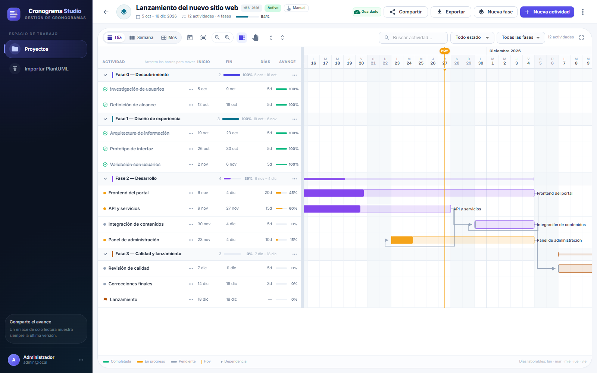

# Cronograma Studio

Aplicación web para gestionar proyectos y crear, editar y compartir cronogramas Gantt **sin escribir código**. Incluye editor visual, fases, dependencias, calendario laboral, exportaciones y enlaces de solo lectura.



> Captura de ejemplo de la interfaz. Una instalación nueva inicia sin proyectos.

## Por qué existe

Este proyecto nació de una necesidad práctica: mantener cronogramas de proyecto sin editar código ni regenerar una imagen cada vez que cambiaba una fecha. Quería tener las actividades en un solo lugar, poder ajustar fechas en una vista visual y compartir un enlace que siempre mostrara la versión actual.

## Funcionalidades

### Proyectos
- Panel con todos los proyectos, búsqueda, filtros por estado y ordenamiento.
- Crear, editar, duplicar, archivar y eliminar proyectos.
- Progreso general calculado por duración (excluye hitos y filas resumen).
- Configuración de color, estado, fechas, calendario laboral, festivos, zona horaria, fecha de referencia y vista inicial.

### Editor Gantt
- Vista **diaria, semanal y mensual**, con encabezados agrupados por mes/año.
- Tabla fija a la izquierda con inicio, fin, duración y avance.
- Escala con zoom, ajuste a pantalla, navegación a hoy y pantalla completa.
- Fines de semana, festivos y línea de **hoy** (o fecha de referencia).
- Fases expandibles/contraíbles y actividades anidadas.
- Arrastrar barras para mover fechas y jalar los extremos para cambiar la duración. Cada movimiento se guarda en la base de datos.
- **Modo mano**: activa el arrastre del lienzo para desplazarte horizontal y verticalmente mientras la edición queda deshabilitada. Se puede activar y desactivar desde la barra del Gantt, o mantener presionada la **barra espaciadora** con el cursor sobre el diagrama para usarlo de forma temporal.
- **Tabla ajustable**: arrastra el borde derecho de la tabla para reducirla hasta 460 px. No puede superar su ancho original; doble clic restaura el tamaño y la preferencia se guarda en el navegador.
- Barras con avance, colores personalizados, hitos y actividades resumen.
- Dependencias **Fin → Inicio** con flechas; se pueden editar (retraso) o eliminar haciendo clic en la flecha.
- Validación de ciclos y de fechas.
- Modo **manual** (las dependencias solo se muestran) y **automático** (las sucesoras se reprograman).
- Reprogramar dependencias manualmente desde el menú del proyecto.
- Buscar y filtrar por estado o fase; contraer todas las fases.
- Editar actividad en un panel lateral con fechas, duración laborable/natural, avance, estado, prioridad, fase, actividad padre, color, responsable, notas y predecesoras.
- Reordenar actividades con «Mover arriba / abajo» (dentro de su fase y padre).
- Duplicar y eliminar actividades con confirmación.

### Compartir
- Enlace público de **solo lectura** con token aleatorio.
- El enlace refleja los cambios actuales: la vista se actualiza sola cada 30 segundos o al recargar.
- Expiración opcional, contraseña opcional y revocación inmediata.
- La vista pública permite buscar, filtrar, cambiar escala, colapsar fases y exportar PNG/SVG/PDF/Excel/CSV, pero no editar.
- Versiones guardadas (snapshots) consultables aparte, sin cambiar cuando el proyecto sigue avanzando.

### Importar y exportar
- Importar `@startgantt` de PlantUML con **previsualización**, resumen de fases/actividades/dependencias y avisos de todo lo que no se pudo interpretar.
- Se conserva el código original importado en la base de datos.
- Exportar **PDF, PNG, SVG, Excel (.xlsx), CSV, JSON y PlantUML** desde el editor y desde el enlace público (excepto JSON/PlantUML en público).

### Acceso
- Inicio de sesión con JWT.
- Usuario administrador inicial configurable por variables de entorno.
- Cambio de contraseña desde el menú de usuario.
- Enlaces públicos sin sesión.

## Inicio rápido (Windows / macOS / Linux)

Requisitos: **Node.js 24 LTS (24.22.3 o superior)** y npm 11.

```bash
npm install
npm run db:push
npm run seed
npm run dev
```

Abre **http://localhost:5173**.

Credenciales iniciales:

```text
Correo:     admin@local
Contraseña: admin123
```

Cámbialas en el menú de usuario o con las variables `ADMIN_EMAIL` / `ADMIN_PASSWORD` antes de hacer `npm run seed`.

El primer arranque deja el panel **vacío**: no se cargan proyectos automáticamente. Desde ahí puedes crear un proyecto o importar tu cronograma PlantUML.

También existe:

```bash
npm run setup   # install + db:push + seed
npm test        # pruebas del calendario, programación y parser PlantUML
```

## Cómo compartir el cronograma

El enlace compartido usa la dirección desde la que estás abriendo la aplicación. Para que funcione fuera de tu computadora:

### Opción A — misma red (rápido)
```bash
npm run build
npm start
```
Abre `http://TU-IP-LOCAL:4000`, inicia sesión y crea el enlace desde ahí. La otra persona debe estar en la misma red y el firewall debe permitir el puerto 4000.

### Opción B — internet con Cloudflare Tunnel (sin servidor)
1. Instala [cloudflared](https://developers.cloudflare.com/cloudflare-one/connections/connect-networks/downloads/).
2. Deja la app corriendo en el puerto 4000 (`npm run build`, `npm start`).
3. Ejecuta:
   ```bash
   cloudflared tunnel --url http://localhost:4000
   ```
4. Abre la URL `https://...trycloudflare.com` que aparece, inicia sesión **desde esa URL** y genera el enlace compartido desde ahí.

> Importante: si creas el enlace abriendo `localhost`, el enlace apuntará a `localhost` y no funcionará para otra persona. Créalo desde la URL pública.

### Opción C — Docker / VPS
```bash
docker compose up -d --build
```
Abre `http://IP-DEL-SERVIDOR:4000`. Edita `JWT_SECRET` y `ADMIN_PASSWORD` en `docker-compose.yml`. La base SQLite queda en el volumen `cronograma-data`.

Para producción real, pon un proxy HTTPS (Caddy, Nginx, Traefik) delante del puerto 4000.

## Variables de entorno

Archivo: `backend/.env` (hay una plantilla en `backend/.env.example`).

| Variable | Uso | Default |
|---|---|---|
| `DATABASE_URL` | Ruta de SQLite o URL de PostgreSQL | `file:./dev.db` |
| `JWT_SECRET` | Firma de sesiones | secreto de desarrollo |
| `PORT` | Puerto del API y del frontend compilado | `4000` |
| `NODE_ENV` | `development` / `production` | `development` |
| `ADMIN_NAME` | Nombre del usuario inicial | `Administrador` |
| `ADMIN_EMAIL` | Correo del usuario inicial | `admin@local` |
| `ADMIN_PASSWORD` | Contraseña del usuario inicial | `admin123` |

## Estructura del proyecto

```text
diagram-projects/
├── backend/                  API Express + Prisma + SQLite
│   ├── prisma/schema.prisma  Modelo relacional
│   └── src/
│       ├── routes/           auth, proyectos, actividades, dependencias,
│       │                     compartir, snapshots, importar/exportar
│       ├── calendar.ts       Reglas de días laborables y duración
│       ├── schedule.ts       Dependencias, cascadas y detección de ciclos
│       ├── plantuml.ts       Parser y generador PlantUML
│       ├── projectService.ts DTOs, progreso y duplicado
│       └── seed.ts           Usuario administrador inicial
├── frontend/                 React + TypeScript + Vite + MUI
│   └── src/
│       ├── pages/            Login, panel, editor, importar, compartir
│       ├── features/gantt/   Gantt SVG, editor, diálogos y exportación
│       ├── lib/              Fechas puras, calendario, etiquetas
│       └── components/       Shell, logo, toasts, confirmaciones
├── docs/                     Decisiones, capturas e historial
├── THIRD_PARTY_NOTICES.md    Licencias de dependencias y tipografía
├── LICENSE                   PolyForm Noncommercial 1.0.0
├── Dockerfile
├── docker-compose.yml
└── package.json              Workspaces y scripts raíz
```

## Modelo de datos

- **User**: administrador con contraseña hasheada.
- **Project**: configuración, calendario (`workingDays`, `holidays`), modo de programación, fechas, color, referencia y código PlantUML original.
- **Phase**: agrupación ordenable dentro del proyecto.
- **Activity**: tarea, hito o resumen; fechas ISO (`YYYY-MM-DD`), duración, avance, estado, prioridad, color, responsable, notas, jerarquía (`parentId`) y orden.
- **Dependency**: predecesora/sucesora, tipo (FS implementado), retraso (`lag`).
- **ShareLink**: hash del token, expiración, contraseña opcional hasheada, estado y último acceso.
- **ProjectSnapshot**: copia JSON consistente del proyecto para consulta histórica.

No se guarda el cronograma como un único bloque de texto: cada actividad, fase y dependencia es una fila consultable.

## Reglas de fechas

- Las fechas se guardan como `YYYY-MM-DD` y se manipulan en UTC para evitar saltos por zona horaria.
- **Inicio y fin son inclusivos.**
- La duración por defecto se cuenta en **días laborables**, saltando fines de semana y festivos.
- La duración en días naturales también está disponible por actividad.
- Fin → Inicio significa: la sucesora empieza el **siguiente día laborable** después del fin de la predecesora, más el retraso configurado.
- En modo automático, mover una actividad reprograma a sus descendientes. También se alinea una actividad con sus predecesoras al guardarla.
- Los ciclos de dependencias se rechazan en el backend y se muestran en la interfaz.

## Exportaciones

- **PNG/SVG/PDF**: render vectorial propio que incluye tabla, calendario, fases, barras, avances, dependencias, línea de hoy y leyenda. El PDF se ajusta a una hoja A3 horizontal.
- **Excel/CSV**: una fila por actividad, más hojas de dependencias y metadatos en Excel.
- **JSON**: respaldo completo del proyecto, fases, actividades y dependencias.
- **PlantUML**: se genera desde el modelo, no desde el texto original. Incluye fechas, duración, avance, colores, días cerrados y dependencias FS cuando la sintaxis lo permite.

## Compatibilidad con PlantUML

El proyecto puede importar y exportar un subconjunto del formato de texto Gantt de PlantUML (`@startgantt` … `@endgantt`). El parser y el generador son propios y están implementados en TypeScript.

**No es un fork ni incluye código de PlantUML**, y no está afiliado ni respaldado por sus autores. PlantUML es un proyecto independiente de sus respectivos autores; aquí solo se ofrece compatibilidad de formato para facilitar la migración de cronogramas existentes.

```plantuml
@startgantt
title Mi proyecto
Project starts 2026-10-05
projectscale weekly
saturday are closed
sunday are closed

-- Fase 1 - Planeación --
[Diseño] starts 2026-10-05
[Diseño] lasts 5 days
[Diseño] is 50% completed
[Diseño] is colored in #FF0000

-- Fase 2 - Ejecución --
[Desarrollo] starts at [Diseño]'s end
[Desarrollo] lasts 10 days

today is 2026-10-20 and is colored in orange
@endgantt
```



También se registran como avisos las líneas que no se entienden; no se descartan en silencio.

## Pruebas

```bash
npm test
```

Cubren:
- conteo de días laborables, festivos, duración y siguiente día laborable;
- reprogramación en cascada, retrasos, hitos y detección de ciclos;
- importación y exportación PlantUML.

## Historial de cambios

La evolución del producto, los ajustes de UX posteriores al MVP y los pendientes están documentados en [docs/CAMBIOS.md](docs/CAMBIOS.md).

## Decisiones y limitaciones

- **SQLite** en lugar de PostgreSQL para que el proyecto arranque sin instalar servidores. El modelo es relacional y puede migrarse a PostgreSQL cambiando el provider de Prisma y `DATABASE_URL`. Ver [docs/ARQUITECTURA.md](docs/ARQUITECTURA.md).
- **Express + TypeScript** en lugar de NestJS para mantener el MVP compacto. La separación por rutas/servicios permite migrar a NestJS sin cambiar el modelo.
- **Gantt SVG propio** en lugar de SVAR: permite controlar el diseño diario/semanal/mensual, las dependencias, los festivos y la exportación vectorial sin licencias PRO.
- Un solo usuario administrador; no hay miembros por proyecto ni roles. Los enlaces públicos cubren la consulta sin cuenta.
- Colaboración en tiempo real, deshacer/rehacer, auditoría detallada y arrastrar para reordenar no están implementados todavía.
- La vista compartida se actualiza cada 30 s; no usa WebSockets.
- El PDF se ajusta a una página A3; para rangos diarios muy largos conviene exportar en escala semanal o mensual.
- Las versiones guardadas se consultan pero no hay botón para restaurarlas sobre el proyecto actual.
- El modo automático implementa dependencias FS. El modelo admite otros tipos, pero la interfaz solo crea FS.
- No hay límite de intentos de contraseña en el login (pensado para uso local/equipo pequeño).

## Respaldo

- SQLite: copia `backend/prisma/dev.db` (o el archivo del volumen `/data/cronograma.db` en Docker).
- Respaldo lógico: exporta JSON de cada proyecto.
- Versión congelada: guarda una versión desde el menú del proyecto.

## Estado del proyecto

Es una primera versión funcional, pensada para proyectos personales y equipos pequeños. Todavía no está preparada para cientos de usuarios concurrentes ni para edición colaborativa en tiempo real.

Las siguientes mejoras naturales son usuarios y roles por proyecto, restauración de versiones y edición por arrastre de la jerarquía.

## Licencia

Copyright © 2026 **José Emanuel Rodríguez Montes**.

Este proyecto se distribuye bajo **PolyForm Noncommercial 1.0.0**. Puedes consultar el texto completo en [LICENSE](LICENSE).

La licencia permite usos personales, educativos, de investigación y por organizaciones sin fines de lucro, pero **no permite el uso comercial**. Para una licencia comercial, escribe a **j.emanuel.rdz.m@hotmail.com**.

PolyForm Noncommercial 1.0.0 es una licencia source-available, no una licencia open source aprobada por OSI. Las dependencias de terceros conservan sus propias licencias.

## Créditos y licencias de terceros

Las dependencias, la tipografía y sus licencias están documentadas en [THIRD_PARTY_NOTICES.md](THIRD_PARTY_NOTICES.md). La licencia PolyForm Noncommercial se aplica únicamente al código propio del proyecto.
